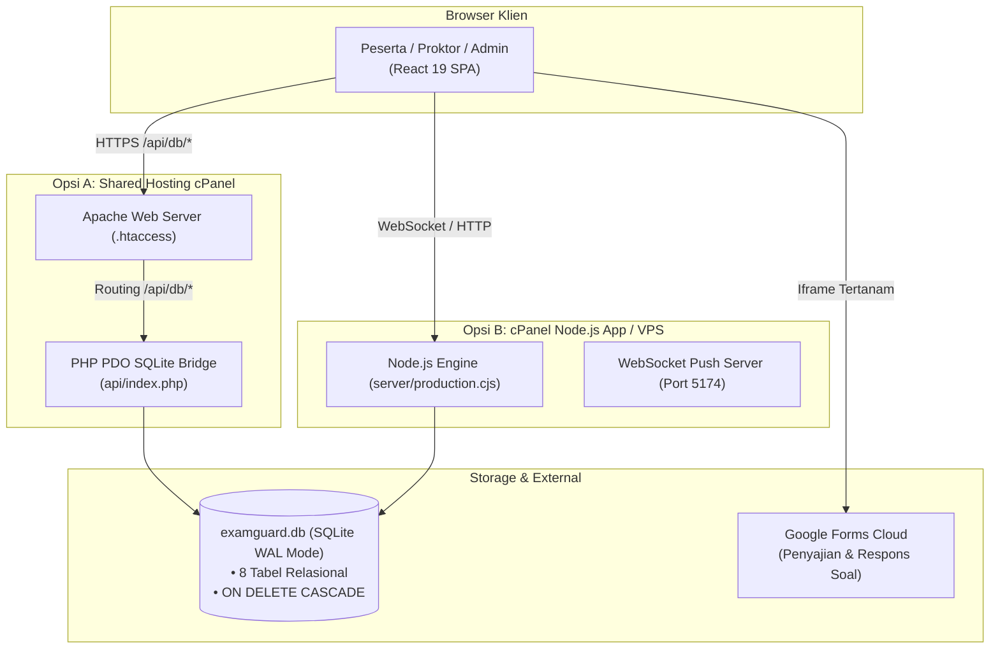

# 🛡️ ExamGuard v1.0 - Enterprise Exam Browser & Geofencing System

<div align="center">

[](https://github.com/chriz27/examguard)
[](https://github.com/chriz27/examguard)
[](https://react.dev)
[](https://vitejs.dev)
[](https://sqlite.org)
[](https://php.net)
[](https://cpanel.net)
[](https://tailwindcss.com)
[](https://leafletjs.com)

**Platform Pengawasan Ujian Berbasis Web Generasi Baru untuk Google Form dengan Proteksi Anti-Curang Tingkat Enterprise, Geofencing GPS Terkunci, Multi-Device Lock, dan Dua Mode Deployment cPanel (Shared Hosting & Node.js).**

*Dikembangkan oleh: **Fandi dari Jawa tech** • Status Rilis: **Versi 1.0 (Production Ready)***

[Fitur Utama](#-fitur-utama) • [Keamanan Enterprise](#-keamanan--cybersecurity-level-enterprise) • [Panduan Deploy cPanel](#-panduan-lengkap-deployment-ke-cpanel-domain--subdomain) • [Panduan Dev Lokal](#-panduan-instalasi-lokal-mode-pengembang) • [Kredensial Akun](#-kredensial-akun-demo-pengujian)

</div>

---

## 📋 Daftar Isi

1. [Tentang ExamGuard v1.0](#-tentang-examguard-v10)
2. [Fitur Utama](#-fitur-utama)
3. [Keamanan & Cybersecurity Level Enterprise](#-keamanan--cybersecurity-level-enterprise)
4. [Arsitektur Sistem & Dual Deployment cPanel](#-arsitektur-sistem--dual-deployment-cpanel)
5. [Panduan Lengkap Deployment ke cPanel (Domain & Subdomain)](#-panduan-lengkap-deployment-ke-cpanel-domain--subdomain)
   - [Metode 1: cPanel Shared Hosting (PHP 8.x + SQLite PDO) - Paling Praktis](#metode-1-cpanel-shared-hosting-php-8x--apache--sqlite-pdo---sangat-direkomendasikan)
   - [Metode 2: cPanel Node.js Application (CloudLinux / Passenger)](#metode-2-cpanel-setup-nodejs-app-cloudlinux--passenger)
   - [Konfigurasi Subdomain (`ujian.sekolah.sch.id`)](#langkah-konfigurasi-subdomain)
   - [Aktivasi SSL HTTPS Gratis (AutoSSL / Let's Encrypt)](#langkah-aktivasi-ssl-https-gratis)
6. [Basis Data Relasional SQLite & REST API](#-basis-data-relasional-sqlite--rest-api)
7. [Panduan Instalasi Lokal (Mode Pengembang)](#-panduan-instalasi-lokal-mode-pengembang)
8. [Kredensial Akun Pengujian](#-kredensial-akun-demo-pengujian)
9. [Struktur Berkas Proyek](#-struktur-berkas-proyek)
10. [Pemecahan Masalah (Troubleshooting)](#-pemecahan-masalah-troubleshooting)
11. [Kredit & Lisensi](#-kredit--lisensi)

---

## 💡 Tentang ExamGuard v1.0

**ExamGuard** adalah sistem peramban ujian (*exam browser & proctoring webapp*) kelas enterprise yang dirancang khusus untuk memproteksi pelaksanaan ujian digital menggunakan **Google Forms**. 

Aplikasi ini membungkus formulir ujian dalam sandbox peramban tertutup yang ketat, mengunci siswa dari tindakan manipulasi koordinat, perpindahan tab, screenshot, dan pembagian akun, sekaligus menyediakan kontrol pengawasan *real-time* kepada proktor dan super admin sekolah.

ExamGuard Versi 1.0 dirancang dengan pendekatan **Dual-Backend Architecture**:
1. **Shared Hosting Ready:** Siap dijalankan di shared hosting cPanel biasa hanya dengan PHP 8.x dan SQLite PDO (tanpa perlu VPS atau langganan server Node.js khusus).
2. **Node.js Ready:** Siap dijalankan di cPanel Node.js App, VPS Linux, Docker, maupun Phusion Passenger dengan dukungan WebSocket push berlatensi rendah (< 10 ms).

---

## ✨ Fitur Utama

### 1. 🔒 Kiosk Lockdown & Anti-Cheat Engine
- **Fullscreen Enforcer (Layar Penuh Terkunci):** Siswa wajib berada dalam mode fullscreen selama ujian. Apabila keluar dari mode layar penuh, layar langsung terkunci (*auto-lock screen*) dan pelanggaran tercatat.
- **Urutan Pre-Flight Check Teroptimasi:** Permintaan izin Fullscreen diposisikan di urutan terakhir (No. 8) pada cek kelayakan sistem, sehingga dialog izin peramban lain (GPS, Kamera, Suara, Notifikasi) tidak membatalkan mode layar penuh siswa.
- **Focus & Visibility Watchdog:** Mendeteksi perpindahan tab browser (`visibilitychange`), hilangnya fokus jendela (`window.blur`), maupun pembukaan aplikasi split-screen.
- **Keyboard & Shortcut Blocker:** Memblokir tombol `Alt+Tab`, `Windows Key`, `Ctrl+W`, `Ctrl+C`, `Ctrl+V`, `Ctrl+U`, `F11`, `F12` (Inspect Element), serta klik kanan.
- **Clipboard Cleaner:** Membersihkan buffer papan klip secara berkala untuk mencegah kecurangan salin-tempel soal ujian.

### 2. 📍 GPS Geofencing Terkunci & Peta Interaktif
- **Penguncian GPS Hardware:** Pin lokasi siswa dikunci 100% berdasarkan sensor hardware GPS perangkat (`navigator.geolocation`). Siswa tidak dapat menggeser pin lokasi secara manual.
- **Modal Peta Lebar & Live Distance:** Fitur "Periksa Lokasi" di portal peserta membuka jendela peta resolusi tinggi (OpenStreetMap & Leaflet) yang menampilkan posisi real-time peserta, titik pusat sekolah, radius toleransi (lingkaran geofence), serta garis jarak dinamis antara siswa dan sekolah.
- **Formula Haversine:** Perhitungan jarak akurat hingga satuan meter tanpa ketergantungan API berbayar.
- **Custom Marker Icon:** Menampilkan logo resmi instansi/sekolah pada pin peta pusat sekolah, atau ikon gedung otomatis jika logo belum diatur.

### 3. 🆔 Multi-Device Lock (One-Device Policy)
- **Pengikatan Hardware ID:** Setiap akun siswa diikat ke satu perangkat melalui fingerprint perangkat (`Device ID`).
- **Tampilan Device ID di Beranda Siswa:** Kartu identitas siswa di portal peserta menampilkan Device ID aktif yang terikat.
- **Pencegahan Akun Ganda:** Siswa lain tidak dapat membuka akun yang sama dari smartphone atau laptop lain.
- **Proctor Reset Device:** Proktor dapat melepaskan ikatan perangkat secara instan jika siswa mengalami kerusakan perangkat di ruang ujian.

### 4. 🔑 Google Workspace SSO & Email Duplication Guard
- **Otentikasi Akun Pembelajaran:** Siswa dapat menautkan akun Google Workspace sekolah (`@belajar.id` atau email domain sekolah).
- **Email Conflict Checker:** Sebelum proses penautan Google SSO dinyatakan sukses, sistem secara otomatis memeriksa basis data untuk memastikan alamat email belum digunakan oleh akun siswa lain.
- **Auto-Reset SSO:** Jika admin mengubah email siswa, sistem secara otomatis mereset status tautan SSO demi keamanan.

### 5. 📊 Sorting & Manajemen Tabel Interaktif
- **Sortable Columns:** Seluruh kolom pada tabel **Basis Data Peserta** dan tabel **Daftar Mapel Aktif (Kontrol Pengawas)** memiliki fitur pengurutan (Sorting ASC/DESC) yang responsif.
- **Multi-Filter & Realtime Search:** Pencarian instan berdasarkan nama, NISN, ruang, tingkat kelas, atau rombel.
- **Import Massal CSV/Excel Anti-Duplikasi:** Validasi ketat anti-ganda pada Nomor Ujian, NISN, dan NIS sebelum data dimasukkan ke sistem.

### 6. ⏱️ Sticky Header & Token Ujian Terintegrasi
- **Timer Hitung Mundur Sinkron:** Menghitung sisa durasi ujian siswa secara akurat.
- **Chip Token Soal Click-to-Copy:** Token ujian dapat disalin dengan satu sentuhan tanpa perlu membuka tab baru.
- **Token Selesai (Finish Token):** Mencegah siswa melakukan submit soal sebelum batas waktu minimal terpenuhi.

---

## 🛡️ Keamanan & Cybersecurity Level Enterprise

ExamGuard v1.0 menerapkan prinsip keamanan berlapis (*Defense in Depth*) berstandar industri:

| Vektor Keamanan | Mekanisme Proteksi ExamGuard |
| :--- | :--- |
| **SQL Injection (SQLi)** | 100% Prepared Statements & Parameter Binding pada Node.js (`db.prepare`) dan PHP PDO SQLite. |
| **Pencurian Database (.db)** | Konfigurasi Apache `.htaccess` memblokir akses publik ke `*.db`, `*.sqlite`, `*.json`, `*.wal`, `*.shm`, `*.env`, dan `*.log` (HTTP 403 Forbidden). |
| **Clickjacking & Iframe Hijack** | Header `X-Frame-Options: SAMEORIGIN` aktif; hanya iframe resmi (internal & Google Forms) yang diizinkan. |
| **MIME Sniffing Exploit** | Header `X-Content-Type-Options: nosniff` terpasang di semua berkas dan endpoint API. |
| **Data Integrity & Crash Safety** | Database SQLite berjalan dalam mode **WAL (Write-Ahead Logging)** dengan transaksi ACID dan `PRAGMA synchronous = NORMAL`. |
| **Hardware GPS Spoofing Guard** | Input koordinat peserta dikunci ke sensor geolokasi presisi tinggi (`enableHighAccuracy: true`) tanpa fitur drag manual. |
| **Role-Based Access Control (RBAC)** | Endpoint sensitif (Restore, Reset Database, Konfigurasi Mode) diverifikasi dengan role guard `admin`. |
| **Force HTTPS & HSTS** | Semua permintaan HTTP secara otomatis dialihkan ke HTTPS 301 untuk menjamin enkripsi transmisi sensor peramban. |
| **Directory Traversal / Browsing** | Direktori listing dinonaktifkan (`Options -Indexes`). |

---

## 🏗️ Arsitektur Sistem & Dual Deployment cPanel

ExamGuard v1.0 mendukung dua model implementasi di hosting cPanel:



---

## 🌐 Panduan Lengkap Deployment ke cPanel (Domain & Subdomain)

### Metode 1: cPanel Shared Hosting (PHP 8.x + Apache + SQLite PDO) - *Sangat Direkomendasikan*

Metode ini adalah cara termudah dan paling hemat. Dapat dijalankan di paket web hosting mana pun (termasuk shared hosting murah) tanpa perlu fitur Node.js.

#### Langkah 1: Kompilasi Proyek (Build)
Jalankan perintah build di komputer lokal Anda:
```bash
npm run build
```
Proses ini akan menghasilkan folder `dist/` yang telah berisi:
- `dist/index.html` (Entrypoint frontend)
- `dist/assets/` (CSS & JS terkompresi)
- `dist/.htaccess` (Konfigurasi keamanan Apache)
- `dist/api/index.php` (PHP PDO SQLite API Bridge)
- `dist/api/.htaccess` (Proteksi database)

#### Langkah 2: Kompres Folder `dist/` ke Format ZIP
Masuk ke dalam folder `dist/`, pilih semua file dan folder di dalamnya, lalu kompres menjadi file zip (contoh: `examguard-v1.0.zip`).
> [!IMPORTANT]
> Pastikan file tersembunyi seperti `.htaccess` di dalam `dist/` dan di dalam `dist/api/` ikut terkompres ke dalam file ZIP.

#### Langkah 3: Unggah ke cPanel File Manager
1. Masuk ke cPanel hosting Anda (`https://namadomain.com:2083`).
2. Buka menu **File Manager**.
3. Navigasikan ke direktori target:
   - **Untuk Domain Utama:** Buka direktori `public_html/`.
   - **Untuk Subdomain (misal `ujian.sekolah.sch.id`):** Buka direktori root subdomain Anda (biasanya `public_html/ujian/` atau direktori terpisah di luar `public_html`).
4. Klik tombol **Upload** di menu atas cPanel, lalu pilih berkas `examguard-v1.0.zip`.
5. Setelah unggahan selesai, klik kanan pada berkas zip tersebut dan pilih **Extract**.
6. Hapus berkas zip untuk menghemat ruang penyimpanan.

#### Langkah 4: Unggah Database Awal (Opsional)
Jika Anda ingin membawa data peserta dan pengaturan yang telah Anda buat di lokal:
- Unggah berkas `examguard.db` dari komputer lokal ke folder yang sama dengan `index.html` (atau satu tingkat di atasnya).
- *Catatan:* Jika Anda tidak mengunggah `examguard.db`, sistem PHP bridge akan **secara otomatis membuat database baru** beserta data akun demo bawaan saat halaman pertama kali dibuka!

---

### Metode 2: cPanel "Setup Node.js App" (CloudLinux / Passenger)

Gunakan metode ini jika hosting Anda menyediakan fitur **Setup Node.js App** (cPanel CloudLinux / VPS).

1. Unggah seluruh direktori proyek (atau hasil clone Git) ke direktori di luar `public_html` (misal: `/home/user/examguard-app`).
2. Masuk ke cPanel dan buka menu **Setup Node.js App**.
3. Klik tombol **Create Application**:
   - **Node.js version:** Pilih versi `20.x` atau `22.x`.
   - **Application mode:** Pilih `Production`.
   - **Application root:** Masukkan direktori aplikasi (contoh: `examguard-app`).
   - **Application URL:** Pilih domain atau subdomain Anda.
   - **Application startup file:** Masukkan `app.js`.
4. Klik **Create**.
5. Klik tombol **Run NPM Install** pada panel aplikasi Node.js.
6. Klik **Restart Application**. Aplikasi kini berjalan penuh dengan Node.js dan WebSocket real-time.

---

### Langkah Konfigurasi Subdomain

Agar ujian terlihat profesional dan tidak mengganggu website utama sekolah, buatlah subdomain (contoh: `ujian.sekolah.sch.id` atau `cbt.sekolah.sch.id`):

1. Masuk ke cPanel &rarr; pilih menu **Domains** atau **Subdomains**.
2. Klik **Create A New Domain**:
   - Masukkan nama domain: `ujian.sekolah.sch.id`.
   - **Document Root:** Centang/isi direktori tujuan (misal: `public_html/ujian` atau `/ujian.sekolah.sch.id`).
3. Pastikan DNS Record (A Record atau CNAME) untuk subdomain tersebut sudah mengarah ke IP hosting Anda.
4. Unggah berkas hasil build ExamGuard ke Document Root tersebut.

---

### Langkah Aktivasi SSL HTTPS Gratis

> [!CAUTION]
> Peramban web modern (Google Chrome, Edge, Safari) **MEMBLOKIR** sensor Geolocation GPS, Kamera, dan Layar Penuh jika website berjalan di atas protokol tidak aman (HTTP). Anda **WAJIB** mengaktifkan HTTPS!

1. Masuk ke cPanel &rarr; buka menu **SSL/TLS Status**.
2. Centang domain/subdomain ujian Anda (misal `ujian.sekolah.sch.id`).
3. Klik tombol **Run AutoSSL**.
4. Tunggu 1–3 menit hingga muncul ikon gembok hijau (*cPanel AutoSSL / Let's Encrypt Certificate Valid*).
5. Berkas `.htaccess` ExamGuard sudah dilengkapi aturan otomatis untuk mengarahkan seluruh pengunjung dari `http://` ke `https://` (*Force 301 HTTPS Redirect*).

---

## 🗄️ Basis Data Relasional SQLite & REST API

ExamGuard menggunakan arsitektur relasional murni dengan 8 tabel ACID yang dioptimalkan:

```text
├── institution           (Konfigurasi instansi, logo, GPS geofence, OAuth)
├── users                 (Super Admin, Proktor, Peserta Ujian)
├── exam_sessions         (Daftar mapel, link Google Form, token soal)
├── student_attempts      (Pengerjaan siswa, status pengerjaan, log pelanggaran)
├── exam_attendance       (Daftar hadir presensi siswa per mapel)
├── berita_acara_config   (Format berita acara ujian & kop sekolah)
├── app_mode_config       (Penegakan mode produksi vs simulasi)
└── system_error_logs     (Audit trail & rekaman diagnosa error sistem)
```

### Daftar Endpoint REST API (`/api/db/*`)
- `GET /api/db/snapshot` &mdash; Mengambil snapshot seluruh entitas sistem dalam 1 request cepat.
- `GET | POST | PUT /api/db/institution` &mdash; Manajemen instansi, logo, dan GPS geofencing.
- `GET | POST /api/db/users` &mdash; Ambil daftar pengguna dan tambah peserta.
- `GET /api/db/users/by-email/:email` &mdash; Verifikasi duplikasi email sebelum login SSO.
- `PUT /api/db/users/:id/reset-device` &mdash; Melepas ikatan Hardware Device ID peserta.
- `PUT /api/db/users/:id/reset-sso` &mdash; Memutus tautan akun Google Workspace peserta.
- `PUT /api/db/users/:id/reset-password` &mdash; Mengembalikan kata sandi peserta ke default (NIS).
- `POST /api/db/users/import` &mdash; Validasi pra-impor & import massal data peserta.
- `GET | POST | PUT | DELETE /api/db/exam-sessions` &mdash; Manajemen bank sesi ujian.
- `GET | POST /api/db/attempts` &mdash; Sinkronisasi pengerjaan ujian peserta.
- `PUT /api/db/attempts/:studentId/:examId/unlock` &mdash; Membuka kunci peserta yang melanggar.
- `PUT /api/db/attempts/:studentId/:examId/reset-work` &mdash; Reset pengerjaan siswa dari awal.
- `POST /api/db/attempts/bulk` &mdash; Kontrol aksi massal (Reset, Selesaikan, Hapus per rombel).
- `GET | POST /api/db/attendance` &mdash; Presensi kehadiran per sesi ujian.
- `GET /api/db/backup` & `POST /api/db/restore` &mdash; Cadangkan dan pulihkan data sistem secara instan.

---

## 💻 Panduan Instalasi Lokal (Mode Pengembang)

Jika Anda ingin menguji atau memodifikasi kode di komputer lokal:

### 1. Kloning Repository & Instal Dependensi
```bash
git clone https://github.com/chriz27/examguard.git
cd examguard
npm install
```

### 2. Jalankan Dev Server
```bash
npm run dev
```
Akses di peramban: `http://localhost:5173`

### 3. Jalankan Pengujian Database (Integration Tests)
```bash
npm run test:db
```
Suite pengujian akan memverifikasi 40 skenario integritas relasional, foreign key cascade, dan transaksi SQLite.

---

## 🔑 Kredensial Akun Demo Pengujian

| Peran (Role) | Username / NISN | Password | Nomor Ujian | Keterangan |
| :--- | :--- | :--- | :--- | :--- |
| **Super Admin** | `admin` | `admin123` | `-` | Akses penuh: Instansi, Logo, GPS, Kelola Admin, Backup/Restore |
| **Proktor Ujian** | `proktor` | `proktor123` | `-` | Akses operasional: Pemantauan Siswa Live, Bank Soal, Presensi |
| **Peserta 1** | `0123456701` | `7001` (NIS) | `UJN-07-001` | Ahmad Fauzi Pratama (7A) |
| **Peserta 2** | `0123456702` | `7002` (NIS) | `UJN-07-002` | Annisa Rahmawati (7B) |

> [!NOTE]
> Standar format akun siswa: **Username** = `NISN`, **Password** = `NIS`. Jika akun telah terhubung dengan Google SSO, siswa dapat masuk menggunakan tombol "Masuk dengan Google".

---

## 📂 Struktur Berkas Proyek

```text
examguard/
├── api/                       # PHP PDO SQLite API Bridge (Production)
│   ├── .htaccess              # Proteksi keamanan database
│   └── index.php              # REST API Router serbaguna
├── public/                    # Aset statis & template web
│   ├── api/                   # Salinan otomatis ke dist/api saat build
│   └── .htaccess              # Konfigurasi Apache Enterprise
├── server/                    # Backend Node.js
│   ├── db.cjs                 # SQLite Engine (better-sqlite3 & node:sqlite)
│   ├── production.cjs         # Server mandiri Node.js produksi
│   └── test-db.cjs            # 40 Test Suite integrasi database
├── src/                       # Kode sumber React SPA
│   ├── components/            # Komponen modular (Peta, Modal, Timer, Header)
│   ├── pages/                 # Portal Peserta & Dashboard Admin/Proktor
│   └── services/              # dbService (Komunikasi REST API & WebSocket)
├── app.js                     # Entrypoint cPanel Phusion Passenger
├── examguard.db               # Basis data SQLite ACID
├── package.json               # Konfigurasi dependensi proyek
├── vite.config.js             # Konfigurasi Vite & SQLite Plugin Dev
└── README.md                  # Dokumentasi resmi
```

---

## 🛠️ Pemecahan Masalah (Troubleshooting)

### 1. Izin Lokasi GPS Gagal / "Geolocation Denied"
- **Penyebab:** Website diakses melalui HTTP biasa, atau izin lokasi ditolak pada peramban HP siswa.
- **Solusi:** Pastikan URL sudah menggunakan `https://`. Pada smartphone siswa, buka pengaturan situs di Chrome &rarr; pilih **Lokasi** &rarr; ubah menjadi **Izinkan**.

### 2. Error 404 Saat Halaman Direfresh di cPanel
- **Penyebab:** File `.htaccess` tidak terunggah atau modul `mod_rewrite` Apache belum aktif.
- **Solusi:** Pastikan file `.htaccess` ada di folder yang sama dengan `index.html`. Aktifkan opsi "Show Hidden Files" di File Manager cPanel untuk memastikannya.

### 3. File Database `.db` Tidak Bisa Ditulis / Error Read-Only di cPanel
- **Penyebab:** Hak akses folder (permissions) tidak mengizinkan penulisan file oleh web server.
- **Solusi:** Di File Manager cPanel, klik kanan pada folder tempat `examguard.db` berada &rarr; pilih **Change Permissions** &rarr; atur menjadi `755` (atau `644` untuk file `examguard.db`).

### 4. WebSocket Gagal Terhubung di Shared Hosting
- **Penyebab:** Sebagian besar shared hosting standar memblokir port custom (seperti 5174).
- **Solusi:** ExamGuard telah dilengkapi dengan **Smart HTTP Polling Fallback** otomatis di `src/services/dbService.js`. Jika WebSocket tidak tersedia, aplikasi secara otomatis beralih ke sinkronisasi HTTP tanpa ada fitur yang terganggu.

---

## 👨‍💻 Kredit & Lisensi

- **Produk:** ExamGuard v1.0 (Production Release)
- **Tim Pengembang:** **Fandi dari Jawa tech**
- **Lisensi:** Open-Source under the [MIT License](LICENSE)

*Dibangun dengan dedikasi untuk memajukan integritas dan standarisasi ujian digital di Indonesia.*
