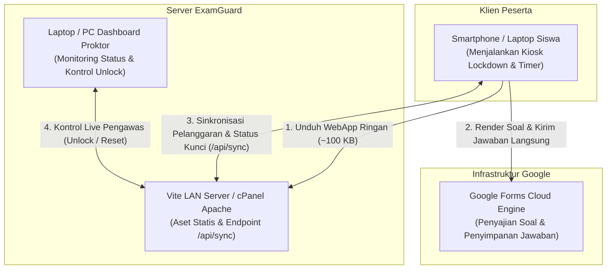
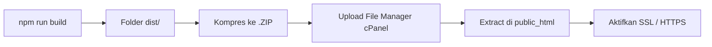

# 🛡️ ExamGuard - GForm Proctoring WebApp

<div align="center">

[](https://github.com/chriz27/examguard)


**Sistem Pengawasan Ujian Berbasis Web Modern untuk Google Form dengan Proteksi Anti-Curang, GPS Geofencing, Google SSO, dan Dua Tingkat Peran Pengawas.**

[Fitur Utama](#-fitur-utama) • [Prasyarat](#-prasyarat-sistem) • [Instalasi Lokal](#-panduan-instalasi-lokal-mode-pengembang) • [Deploy cPanel](#-panduan-instalasi--deployment-ke-cpanel) • [Kredensial Demo](#-kredensial-akun-demo-pengujian) • [Repositori GitHub](https://github.com/chriz27/examguard)

</div>

---

## 📋 Daftar Isi

1. [Tentang ExamGuard](#-tentang-examguard)
2. [Fitur Utama](#-fitur-utama)
3. [Arsitektur & Alur Kerja Sistem](#-arsitektur--alur-kerja-sistem)
4. [Basis Data & Sinkronisasi Hibrida (LAN & Cloud)](#-basis-data--sinkronisasi-hibrida-lan--cloud)
5. [Keamanan, Validasi & Integritas Ujian](#-keamanan-validasi--integritas-ujian)
6. [Skalabilitas & Panduan Pelaksanaan 700+ Peserta](#-skalabilitas--panduan-pelaksanaan-700-peserta)
7. [Prasyarat Sistem](#-prasyarat-sistem)
8. [Panduan Instalasi Lokal (Mode Pengembang)](#-panduan-instalasi-lokal-mode-pengembang)
9. [Panduan Instalasi & Deployment ke cPanel](#-panduan-instalasi--deployment-ke-cpanel)
10. [Kredensial Akun Demo Pengujian](#-kredensial-akun-demo-pengujian)
11. [Alur & Hak Akses Administrator](#-alur--hak-akses-administrator)
12. [Struktur Folder Proyek](#-struktur-folder-proyek)
13. [Konfigurasi Tambahan (OAuth, reCAPTCHA, GPS)](#-konfigurasi-tambahan)
14. [Pemecahan Masalah (Troubleshooting)](#-pemecahan-masalah-troubleshooting)
15. [Lisensi](#-lisensi)

---

## 💡 Tentang ExamGuard

**ExamGuard** adalah aplikasi *proctoring web* (pengawasan ujian) ringan, modern, dan mandiri yang membungkus formulir **Google Form** dalam lingkungan ujian yang aman dan terpantau. Dirancang khusus untuk sekolah (SD, SMP, SMA/SMK) maupun perguruan tinggi yang membutuhkan sistem ujian digital berstandar tinggi tanpa perlu infrastruktur server database yang rumit.

Aplikasi ini **100% Client-Side Ready** dan telah dioptimalkan untuk berjalan mulus baik di **Jaringan Wi-Fi/LAN Lokal** maupun di **Shared Hosting cPanel (Apache / LiteSpeed)** hanya dengan mengunggah paket build `.zip`.

---

## ✨ Fitur Utama

- **🎨 Modern Minimalist Design:** Antarmuka bersih (*anti-AI slop*) menggunakan Tailwind CSS v4, tipografi Inter & JetBrains Mono, border halus, serta modal konfirmasi khusus (tanpa popup bawaan browser).
- **🔒 Anti-Curang Proctoring Engine:**
  - Deteksi perpindahan tab browser (`visibilitychange`).
  - Deteksi hilangnya fokus jendela (`window.blur`).
  - Deteksi keluar dari mode Fullscreen (Layar Penuh).
  - **Auto-Lock Screen** seketika saat terjadi pelanggaran dengan counter akumulasi pelanggaran.
  - Pemblokiran klik kanan, inspect element (`F12`), `Ctrl+C`, `Ctrl+V`, `Ctrl+U`, `Alt+Tab`, serta *anti-translate*.
- **🆔 Validasi 3 Kunci Identitas Anti-Duplikasi:**
  - Verifikasi *real-time* bahwa **Nomor Ujian**, **NISN**, dan **NIS** wajib unik antar siswa.
  - Penandaan kolom merah dan badge `Duplikat` seketika saat admin mengetik data ganda.
  - **Laporan Validasi Import Massal (CSV/Excel):** Mendeteksi duplikasi terhadap data sistem maupun bentrok antar baris dalam file import, lengkap dengan rincian baris dan tombol salin laporan.
- **📍 GPS Geofencing Interaktif (Leaflet & OpenStreetMap):**
  - Preview peta interaktif gratis tanpa Google Maps API berbayar.
  - Pengaturan radius toleransi ujian (50m, 100m, 200m, 500m, dst) menggunakan formula trigonometri *Haversine*.
  - Fitur pencarian lokasi langsung (*live search Nominatim*) dan input tautan Google Maps langsung.
- **🔐 Dua Tingkat Akses Administrator (RBAC):**
  - **Super Admin:** Akses mutlak ke semua fitur, termasuk *Pengaturan Instansi* dan *Kelola Akun Administrator*.
  - **Proktor Ujian:** Khusus operasional lapangan (*Ringkasan & Metrik*, *Sesi Ujian*, *Kontrol Pengawas Live*, dan *Manajemen Siswa*). Menu sensitif otomatis disembunyikan.
- **⚡ Kontrol Pengawas Real-Time:**
  - **Unlock:** Membuka kembali siswa yang terkunci tanpa reload.
  - **Reset Login:** Melepas ikatan *Device ID* siswa jika ganti perangkat.
  - **Reset Pekerjaan:** Mengembalikan status ujian menjadi `RESET_BY_PROCTOR` agar siswa dapat mengulang dari awal.
  - **Reset Password & Reset SSO:** Reset password instan ke default NIS dan pencabutan koneksi Google SSO per siswa.
- **🏷️ Sticky Header Ujian:** Timer hitung mundur pengerjaan, chip token soal sekali-klik salin (*click-to-copy*), dan konfirmasi submit ujian.
- **🌐 Google Workspace SSO & reCAPTCHA v2:** Dukungan integrasi OAuth login sekolah dan verifikasi bot reCAPTCHA v2 dengan kontrol toggle on/off.
- **🏫 Identitas Sekolah & NPSN Resmi:** Konfigurasi nama sekolah, jenjang pendidikan, serta input validasi **NPSN 8 digit angka numerik** yang tersimpan di basis data sistem dan tampil pada header aplikasi.
- **💾 Backup & Restore Terenkripsi (AES-256-GCM):** Fasilitas pencadangan dan pemulihan data instansi, link bank soal, basis data siswa, serta riwayat ujian dengan **enkripsi militer AES-256-GCM** otomatis untuk password dan kunci rahasia Google.
- **⚡ Code-Splitting Modular:** Bundle portal siswa dipisah secara *lazy load* (`~100 KB gzipped`) sehingga loading di smartphone peserta sangat cepat dan hemat kuota/RAM.

---

## 🏗️ Arsitektur & Alur Kerja Sistem

ExamGuard mengusung arsitektur **Hybrid Client-Centric Single Page Application (SPA)**. Alih-alih membebani server sekolah dengan ribuan kueri database SQL setiap detik, ExamGuard memisahkan beban secara cerdas:



### 1. Pemisahan Beban Komputasi
* **Beban Soal & Jawaban:** Ditangani 100% oleh **Google Forms**. Server sekolah tidak akan pernah mengalami *database connection pool timeout* atau *MySQL crash* saat ratusan siswa menekan tombol submit bersamaan.
* **Beban Pengawasan (Proctoring):** Timer ujian, deteksi fullscreen, pendeteksi ganti aplikasi, dan GPS Geofencing berjalan di memori browser HP masing-masing siswa.

### 2. Dual-Mode Deployment (Fleksibilitas Jalur Penerapan)
* **Mode Offline LAN / Wi-Fi Lokal:** Komputer proktor menjalankan server lokal via Vite dengan plugin bawaan `examGuardLanSyncPlugin`. Laptop proktor bertindak sebagai host di jaringan lokal, dan peserta cukup mengakses alamat IP lokal (contoh: `http://192.168.2.11:5173`).
* **Mode Online Web Hosting (cPanel / Apache):** Aplikasi di-*build* menjadi file statis HTML/JS/CSS dan diunggah ke cPanel. Dilengkapi file `.htaccess` bawaan untuk menangani *SPA routing* dan *Force HTTPS*.

---

## 🗄️ Basis Data & Sinkronisasi Hibrida (LAN & Cloud)

ExamGuard mengimplementasikan **Virtual Relational Storage Layer** berbasis peramban (*offline-first*) yang diorkestrasikan oleh `storageService.js`:

### 1. Skema Entitas Data Terstruktur
* `USERS`: Menyimpan identitas siswa dan administrator (`id`, `nama`, `nomor_ujian`, `nisn`, `nis`, `kelas`, `tingkat`, `email`, `role`, `is_active`, `google_linked`, `active_device_id`).
* `EXAM_SESSIONS`: Bank soal dan sesi ujian aktif (`id`, `title`, `token`, `google_form_url`, `duration_minutes`, `target_grades`, `is_archived`).
* `STUDENT_ATTEMPTS`: Log riwayat pengerjaan (`status`: *NOT_STARTED*, *IN_PROGRESS*, *LOCKED*, *COMPLETED*, *RESET_BY_PROCTOR*, `violation_count`, `last_violation_reason`, `time_spent_seconds`, `unlocked_at`).
* `EXAM_ATTENDANCE`: Rekap presensi kehadiran ujian per siswa dan sesi ujian.
* `INSTITUTION` & `APP_MODE_CONFIG`: Profil sekolah, koordinat GPS geofence, radius toleransi, serta konfigurasi mode produksi (*STRICT*) vs simulasi (*DEV*).

### 2. Mekanisme Sinkronisasi Real-Time Hibrida
* **Sinkronisasi Tab Lokal:** Menggunakan `BroadcastChannel` dan `CustomEvent` browser untuk sinkronisasi instan antar-tab tanpa latensi.
* **Sinkronisasi Antar-Perangkat (LAN/Cloud):** Menggunakan endpoint `/api/sync` dengan algoritma **Smart Conflict-Resolution**:
  * Status `LOCKED` dan riwayat pelanggaran tertinggi peserta diproteksi di level kernel aplikasi agar **tidak dapat dimanipulasi atau di-downgrade** oleh HP siswa tanpa otorisasi resmi proktor.

---

## 🛡️ Keamanan, Validasi & Integritas Ujian

### 1. Kiosk Lockdown Engine
* **Fullscreen Enforcer:** Siswa wajib berada dalam mode layar penuh. Jika keluar dari mode fullscreen, layar terkunci dan sistem mencatat pelanggaran.
* **Focus & Tab Switch Detection:** Event `visibilitychange` dan `window.blur` memantau apakah siswa berpindah tab atau membuka aplikasi split-screen.
* **Pencegahan Tombol Pintasan:** Memblokir kombinasi tombol berbahaya seperti `Alt+Tab`, `Windows Key`, `Ctrl+W`, `Ctrl+C`, `Ctrl+V`, `F11`, `F12` (Inspect Element), serta klik kanan.

### 2. Validasi 3 Kunci Anti-Duplikasi (No Ujian, NISN, NIS)
* **Pada Formulir Tambah & Edit Siswa:** Kolom No. Ujian, NISN, dan NIS memiliki validasi reaktif. Jika ditemukan kesamaan dengan siswa lain, sistem langsung mengunci tombol simpan dan menampilkan nama serta kelas pemilik data asli.
* **Pada Import Massal (CSV / Excel):** Sistem menjalankan audit mendalam sebelum data masuk ke sistem. Jika terdapat data ganda (baik bentrok dengan data yang sudah ada di sekolah maupun antar-baris dalam file import itu sendiri), proses import dibatalkan secara aman dan sistem memunculkan tabel rincian kesalahan lengkap dengan nomor barisnya.

### 3. Keamanan Perangkat & Akun
* **One-Device Lock (Kunci Perangkat):** Akun peserta diikat ke satu perangkat melalui fingerprint `device_id`. Siswa tidak dapat login di perangkat lain secara bersamaan kecuali login perangkat direset oleh proktor.
* **Google SSO Security Auto-Reset:** Jika admin atau proktor memperbarui alamat email siswa di dashboard, tautan SSO Google siswa otomatis diputus (*status OFF*) demi mencegah potensi pembajakan akun.

---

## 📈 Skalabilitas & Panduan Pelaksanaan 700+ Peserta

ExamGuard **sangat aman dan sanggup melayani 700 peserta sekaligus**, karena beban komputasi berat (kuis soal, gambar, dan submit ratusan jawaban) ditangani oleh infrastruktur Google Forms.

Namun, untuk memastikan kelancaran ujian massal di lapangan, perhatikan panduan infrastruktur berikut:

### 1. Titik Kritis Jaringan (*Network Bottlenecks*) & Solusinya
* **Kapasitas Access Point Wi-Fi:** 1 router Wi-Fi standar hanya mampu menampung 30–50 HP. Untuk 700 siswa (~20 ruang kelas), pastikan tiap ruang kelas memiliki Access Point terpisah, atau izinkan siswa menggunakan kuota internet seluler (4G/5G).
* **Efek Stampede Login Serentak:** Hindari 700 siswa membuka aplikasi pada detik yang persis sama. Bagi waktu mulai login per tingkatan kelas dengan selisih 2–3 menit (misal: Kelas 12 pukul 07:45, Kelas 11 pukul 07:48, Kelas 10 pukul 07:51).

### 2. Perbandingan Dua Skenario Penerapan Terbaik

| Parameter | Skenario A: Web Hosting cPanel + Cloudflare (Sangat Direkomendasikan) | Skenario B: Mode Jaringan Lokal Offline (LAN) |
| :--- | :--- | :--- |
| **Bentuk Penerapan** | Diunggah ke cPanel domain sekolah (misal: `cbt.sekolah.sch.id`) dengan CDN gratis Cloudflare. | Komputer/Laptop bertindak sebagai server lokal di jaringan LAN sekolah. |
| **Koneksi Siswa** | Siswa fleksibel menggunakan Wi-Fi sekolah maupun kuota internet HP pribadi. | Siswa wajib terhubung ke Wi-Fi / kabel LAN sekolah yang sama dengan proktor. |
| **Model Pengawasan** | 1 Super Admin & beberapa Proktor dapat memantau 700 siswa secara terpusat dari mana saja. | **Model Terdistribusi:** Bagi per proktor per ruangan (1 Laptop Proktor melayani 30–60 siswa di ruangannya). |
| **Kestabilan** | **Sangat Tinggi (99.9%)**, file statis dilayani oleh edge server CDN Cloudflare. | **Tinggi**, asalkan kapasitas Access Point Wi-Fi di tiap ruang kelas memadai. |

---

---

## 💻 Prasyarat Sistem

Sebelum memulai instalasi, pastikan sistem komputer Anda telah memenuhi prasyarat berikut:

| Komponen | Kebutuhan Minimum | Rekomendasi |
| :--- | :--- | :--- |
| **Node.js** | Versi 18.x LTS | **Versi 20.x atau 22.x LTS** |
| **NPM** | Versi 9.x | **Versi 10.x+** (bawaan Node.js) |
| **Browser** | Google Chrome 100+ / Edge 100+ | **Google Chrome Terbaru** (Dukungan API Sensor Terbaik) |
| **Koneksi Internet** | Diperlukan saat `npm install` dan memuat peta OpenStreetMap |
| **Hosting Target** | Apache / LiteSpeed dengan dukungan `.htaccess` & SSL (HTTPS) |

Periksa versi Node.js & NPM Anda melalui terminal:
```bash
node -v
npm -v
```

---

## 🚀 Panduan Instalasi Lokal (Mode Pengembang)

Ikuti langkah-langkah di bawah ini untuk menjalankan ExamGuard di komputer lokal Anda:

### 1. Kloning Repository atau Unduh Sumber Kode
Jika menggunakan Git:
```bash
git clone https://github.com/chriz27/examguard.git
cd examguard
```
Atau jika menggunakan Laragon / XAMPP, letakkan folder proyek di direktori web server Anda (misal `d:\laragon\www\examguard`).

### 2. Instalasi Paket Dependensi
Jalankan perintah instalasi paket modul Node:
```bash
npm install
```

> [!TIP]
> **Pengguna Windows PowerShell:** Jika muncul error eksekusi skrip (*PSSecurityException*), gunakan perintah `npm.cmd install` atau jalankan `Set-ExecutionPolicy -Scope CurrentUser -ExecutionPolicy RemoteSigned` di PowerShell Administrator.

### 3. Menjalankan Local Development Server
Jalankan server pengembangan berbasis Vite:
```bash
npm run dev
```

Agar aplikasi dapat diakses oleh perangkat lain dalam satu jaringan WiFi/LAN yang sama (misalnya untuk uji coba dari HP siswa):
```bash
npm run dev -- --host 0.0.0.0
```

### 4. Buka Aplikasi di Browser
Buka peramban web dan arahkan ke alamat yang tampil di terminal:
- Akses Lokal: **[http://localhost:5173](http://localhost:5173)**
- Akses Jaringan LAN: `http://[IP-Komputer-Anda]:5173`

---

## 🌐 Panduan Instalasi & Deployment ke cPanel

ExamGuard telah dirancang dengan arsitektur **cPanel-Ready** (menggunakan *relative path* `./` dan file `.htaccess` bawaan untuk mengatasi masalah refresh 404 pada Single Page Application).



### Langkah 1: Buat Bundel Produksi (Build)
Jalankan perintah build pada terminal proyek Anda:
```bash
npm run build
```
Vite akan mengompilasi kode sumber ke dalam folder `dist/` dalam hitungan detik.

### Langkah 2: Siapkan File Arsip (.ZIP)
Kompres seluruh isi di dalam folder `dist/` menjadi file ZIP (misal: `examguard-cpanel-ready.zip`).

> [!IMPORTANT]
> Pastikan file `.htaccess` yang ada di dalam `dist/` ikut terkompres ke dalam file ZIP.

### Langkah 3: Unggah ke cPanel File Manager
1. Masuk ke dashboard **cPanel** hosting sekolah Anda.
2. Buka menu **File Manager**.
3. Masuk ke direktori target:
   - Jika untuk domain utama: buka folder `public_html/`.
   - Jika untuk subdomain (misal `ujian.sekolah.sch.id`): buka folder document root subdomain tersebut (contoh: `public_html/ujian/`).
4. Klik tombol **Upload** di menu atas cPanel, lalu pilih file `examguard-cpanel-ready.zip`.

### Langkah 4: Ekstrak File ZIP di Server
1. Klik kanan pada file ZIP yang baru diunggah di File Manager cPanel, lalu pilih **Extract** (Ekstrak di direktori aktif).
2. Hapus file ZIP setelah diekstrak untuk menghemat ruang penyimpanan hosting.
3. Pastikan struktur file terlihat seperti ini di folder root domain Anda:
   ```text
   public_html/ (atau folder subdomain)
   ├── assets/
   │   ├── index-[hash].css
   │   └── index-[hash].js
   ├── .htaccess
   ├── favicon.ico
   └── index.html
   ```

> [!TIP]
> **Jika file `.htaccess` tidak terlihat di File Manager cPanel:**  
> Klik tombol **Settings** di pojok kanan atas File Manager cPanel, lalu centang opsi **"Show Hidden Files (dotfiles)"** dan klik **Save**.

### Langkah 5: Pastikan SSL (HTTPS) Aktif
Fitur **Geolocation GPS**, **Fullscreen API**, dan **Pembersih Clipboard** mewajibkan protokol aman **HTTPS**:
1. Pastikan fitur **AutoSSL / Let's Encrypt** telah berstatus aktif di cPanel untuk domain/subdomain ujian.
2. File `.htaccess` ExamGuard sudah secara otomatis mengalihkan seluruh lalu lintas HTTP ke HTTPS (*Force HTTPS*).

---

## 🔑 Kredensial Akun Demo Pengujian

Aplikasi telah terisi dengan data bawaan (*seed database*) untuk memudahkan pengujian seluruh fitur dan skenario:

| Peran (Role) | Username / NISN | Password Default | Nomor Ujian | Keterangan & Hak Akses |
| :--- | :--- | :--- | :--- | :--- |
| **Super Admin** | `admin` | `admin` | `-` | **Akses Penuh:** Kelola Instansi, Akun Admin, Bank Soal, Sesi Ujian, & Monitoring |
| **Proktor Ujian** | `proktor` | `proktor` | `-` | **Operasional Ujian:** Monitoring Siswa Live, Bank Sesi, Reset Password/SSO Siswa |
| **Siswa 1** | `0058291021` | `22101` (NIS) | `UJN-12-001` | Ahmad Fauzi Ridwan (XII MIPA 1) • **Terverifikasi**, **SSO Google On** |
| **Siswa 2** | `0058291022` | `22102` (NIS) | `UJN-12-002` | Siti Rahmawati Putri (XII MIPA 2) • **Terverifikasi**, **SSO Google Off** |
| **Siswa 3** | `0068291033` | `23101` (NIS) | `UJN-11-001` | Bambang Pamungkas (XI IPS 1) • **Terverifikasi**, **SSO Google Off** |

> [!NOTE]
> - **Aturan Default Kredensial Siswa:** `Username` = **NISN**, `Password` = **NIS**.
> - Jika akun siswa telah terhubung dengan **Google SSO**, siswa wajib masuk menggunakan tombol **Masuk dengan Google**. Siswa dapat meminta reset SSO ke Super Admin/Proktor jika ingin kembali menggunakan login NISN/NIS biasa.

---

## 👥 Alur & Hak Akses Administrator

ExamGuard membedakan wewenang administrator menjadi dua tingkatan:

```text
┌─────────────────────────────────────────────────────────────┐
│                       SUPER ADMIN                           │
│  (Akses Penuh: Pengaturan Instansi, GForm, Akun, Database)   │
└──────────────────────────────┬──────────────────────────────┘
                               │
               ┌───────────────┴───────────────┐
               ▼                               ▼
     [Pengaturan Instansi &          [Operasional Pengawasan]
      Akun Administrator]                      │
      (Khusus Super Admin)                     ▼
                               ┌──────────────────────────────┐
                               │        PROKTOR UJIAN         │
                               │ • Ringkasan & Metrik         │
                               │ • Bank Sesi Ujian GForm      │
                               │ • Papan Kontrol Pengawas Live│
                               │ • Basis Data Siswa & Reset   │
                               └──────────────────────────────┘
```

1. **Super Admin:**
   - Mengatur identitas instansi (nama sekolah, jenjang SD/SMP/SMA, logo).
   - Mengatur koordinat GPS Geofencing, radius toleransi, dan peta interaktif.
   - Mengatur integrasi Google Workspace SSO Client ID dan Google reCAPTCHA v2.
   - Mengubah kata sandi Super Admin dan akun Proktor Ujian.
2. **Proktor Ujian:**
   - Memantau aktivitas pengerjaan siswa secara langsung (*Live Monitoring*).
   - Melakukan aksi *Unlock* siswa terkunci akibat pelanggaran.
   - Melakukan *Reset Login* perangkat siswa.
   - Mereset password akun siswa ke default NIS dan mereset status Google SSO jika siswa mengalami kendala akun.
   - Menu *Pengaturan Instansi* dan *Akun Administrator* otomatis **disembunyikan** dari sidebar Proktor.

---

## 📁 Struktur Folder Proyek

```text
examguard/
├── dist/                              # Output build siap hosting cPanel
│   ├── assets/                        # Bundle JS & CSS ter-hash
│   ├── .htaccess                      # Aturan SPA routing & Force HTTPS
│   └── index.html                     # Entry point HTML produksi
├── public/
│   ├── .htaccess                      # Konfigurasi Apache bawaan
│   └── favicon.ico                    # Favicon aplikasi
├── src/
│   ├── components/
│   │   ├── admin/
│   │   │   └── AdminSidebar.jsx       # Navigasi panel admin dengan filter role
│   │   └── common/
│   │       ├── ConfirmModal.jsx       # Modal konfirmasi kustom modern
│   │       └── NotificationToast.jsx  # Toast notifikasi kustom modern
│   ├── constants/
│   │   └── educationConfig.js         # Konfigurasi jenjang, Haversine GPS, helper
│   ├── pages/
│   │   ├── admin/
│   │   │   └── AdminDashboard.jsx     # Dashboard terpadu Super Admin & Proktor
│   │   ├── auth/
│   │   │   └── LoginPortal.jsx        # Gerbang login multi-peran & SSO
│   │   └── student/
│   │       └── StudentPortal.jsx      # Pre-flight check, beranda, & ujian GForm
│   ├── services/
│   │   └── storageService.js          # Arsitektur penyimpanan terpusat (LocalStorage)
│   ├── App.jsx                        # Komponen root aplikasi & router
│   ├── index.css                      # Konfigurasi Tailwind CSS v4 & styling font
│   └── main.jsx                       # Entry point React DOM
├── examguard-cpanel-ready.zip         # Arsip siap deploy ke cPanel
├── package.json                       # Konfigurasi dependensi dan skrip npm
├── vite.config.js                     # Konfigurasi Vite (relative base './')
└── README.md                          # Panduan dokumentasi lengkap ini
```

---

## ⚙️ Konfigurasi Tambahan

### 1. Konfigurasi Google Workspace SSO (Mode Produksi Resmi)
Untuk mengaktifkan autentikasi akun Google sekolah (@sekolah.sch.id):
1. Buka [Google Cloud Console](https://console.cloud.google.com/).
2. Buat proyek baru $\rightarrow$ Buka menu **APIs & Services** $\rightarrow$ **Credentials**.
3. Buat **OAuth 2.0 Client IDs** (Web Application).
4. Tambahkan domain sekolah Anda ke dalam **Authorized JavaScript origins** (misal: `https://ujian.sekolah.sch.id` atau `http://localhost:5173`).
5. Salin **Client ID** yang diperoleh, lalu masuk ke ExamGuard sebagai Super Admin $\rightarrow$ Tab **Pengaturan Instansi** $\rightarrow$ Masukkan Client ID pada formulir Google OAuth.
6. Klik tombol **Test Koneksi & Aktifkan**. Begitu terverifikasi, status otomatis beralih ke **AKTIF (ON)**.
> **Catatan Keamanan:** Jika Google OAuth belum dikonfigurasi atau di-reset, tombol SSO pada portal login otomatis **tersembunyi (hidden)** dan seluruh peserta wajib login menggunakan nomor **Nomor Ujian / NISN** dan **Password NIS**.

### 2. Konfigurasi Google reCAPTCHA (v2 Checkbox & v3 Invisible)
ExamGuard mendukung 2 mode API resmi Google reCAPTCHA dan sistem Captcha Mandiri Default:
1. Buka [Google reCAPTCHA Admin Console](https://www.google.com/recaptcha/admin).
2. Daftarkan domain sekolah dengan memilih salah satu tipe:
   - **reCAPTCHA v2 ("I'm not a robot" Checkbox):** Menampilkan kotak centang interaktif yang wajib diselesaikan siswa.
   - **reCAPTCHA v3 (Score-based Invisible):** Verifikasi latar belakang otomatis tanpa mengganggu alur pengerjaan siswa.
3. Masukkan **Site Key** dan **Secret Key** ke tab **Pengaturan Instansi** di ExamGuard, pilih versi yang sesuai (v2 atau v3), lalu klik **Test Koneksi & Aktifkan**.
> **Proteksi Captcha Mandiri (Default):** Jika Google reCAPTCHA belum diset (kosong) atau aplikasi dijalankan pada jaringan tertutup (*offline LAN*), sistem secara otomatis mengaktifkan **Captcha Keamanan Mandiri ExamGuard (Default)** berbasis *visual canvas anti-bot* 5 karakter. Dengan demikian, portal login tetap 100% terlindungi dari serangan *brute-force* bot tanpa bergantung pada koneksi internet luar.

---

## 🛠️ Pemecahan Masalah (Troubleshooting)

| Gejala Masalah | Kemungkinan Penyebab | Langkah Solusi |
| :--- | :--- | :--- |
| **Port 5173 already in use** | Port 5173 sedang dipakai oleh aplikasi lain | Jalankan Vite pada port alternatif: `npm run dev -- --port 5174` |
| **Error 404 saat Refresh di cPanel** | File `.htaccess` belum terunggah atau `mod_rewrite` nonaktif | Pastikan file `.htaccess` berada di folder yang sama dengan `index.html` dan opsi *Show Hidden Files* aktif di cPanel. |
| **Izin Geolocation / GPS Gagal** | Situs dibuka tanpa protokol HTTPS | Akses situs melalui `https://` bukan `http://`. Browser memblokir API sensor pada koneksi non-HTTPS. |
| **Mode Layar Penuh Ditolak** | Pemicuan Fullscreen tanpa interaksi klik | Pastikan siswa mengklik tombol "Buka Soal & Fullscreen". Browser modern melarang otomatisasi fullscreen tanpa klik pengguna. |
| **Peta Leaflet Tidak Muncul / Abu-abu** | Koneksi internet lambat atau kontainer peta belum render | Pastikan perangkat terhubung ke internet untuk memuat tile OpenStreetMap. Peta akan otomatis menyesuaikan ukuran kontainer. |
| **Siswa Terkunci di Perangkat Lama** | Siswa berpindah HP/Laptop tanpa logout | Minta Proktor membuka menu *Kontrol Pengawas* atau *Manajemen Siswa*, lalu klik tombol **Reset Login** pada siswa tersebut. |
| **PSSecurityException di Windows** | PowerShell membatasi eksekusi skrip lokal | Gunakan `npm.cmd [perintah]` atau jalankan perintah PowerShell: `Set-ExecutionPolicy -Scope CurrentUser -ExecutionPolicy RemoteSigned`. |

---

## 📄 Lisensi & Repositori

ExamGuard dirilis di bawah lisensi [MIT](LICENSE). Bebas digunakan, dimodifikasi, dan didistribusikan untuk keperluan instansi pendidikan, sekolah, maupun pelatihan mandiri.

* **Repositori Resmi:** [https://github.com/chriz27/examguard](https://github.com/chriz27/examguard)
* **Author / Maintainer:** [chriz27](https://github.com/chriz27)
