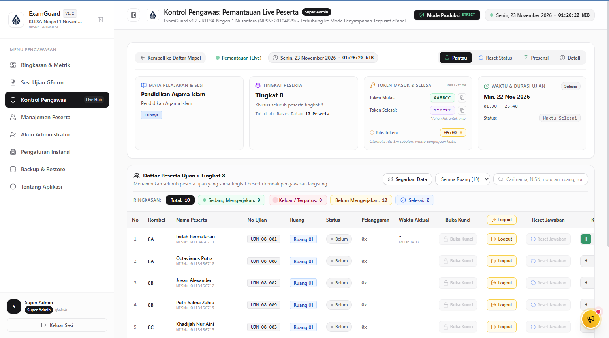
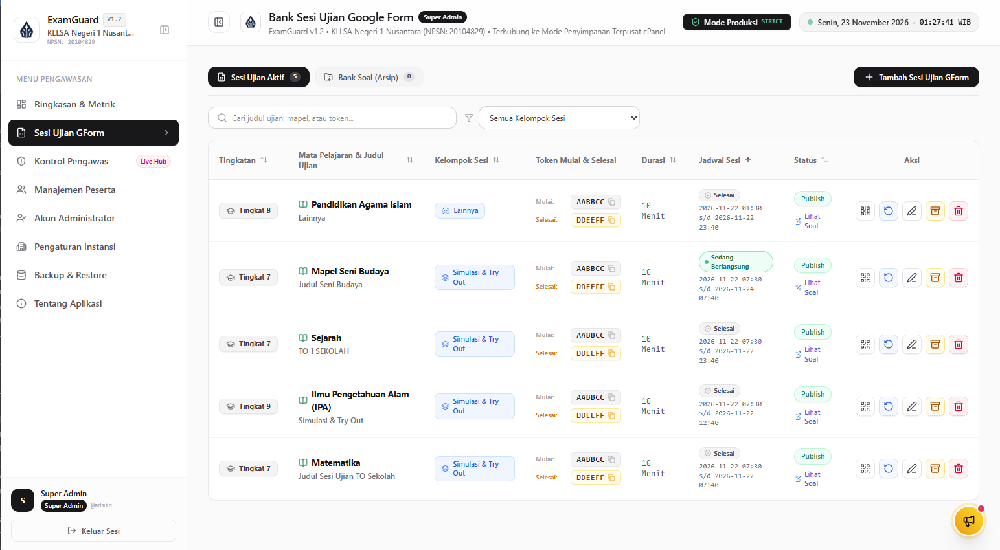
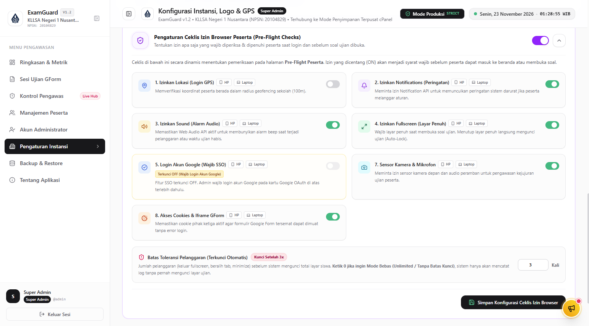
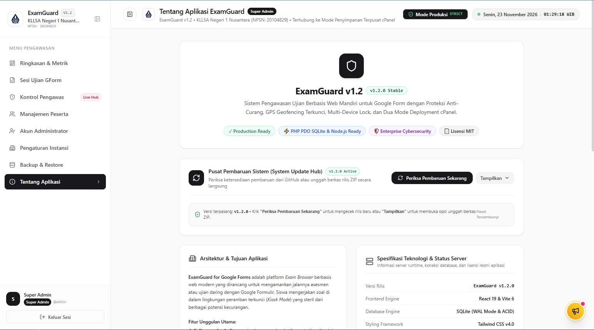
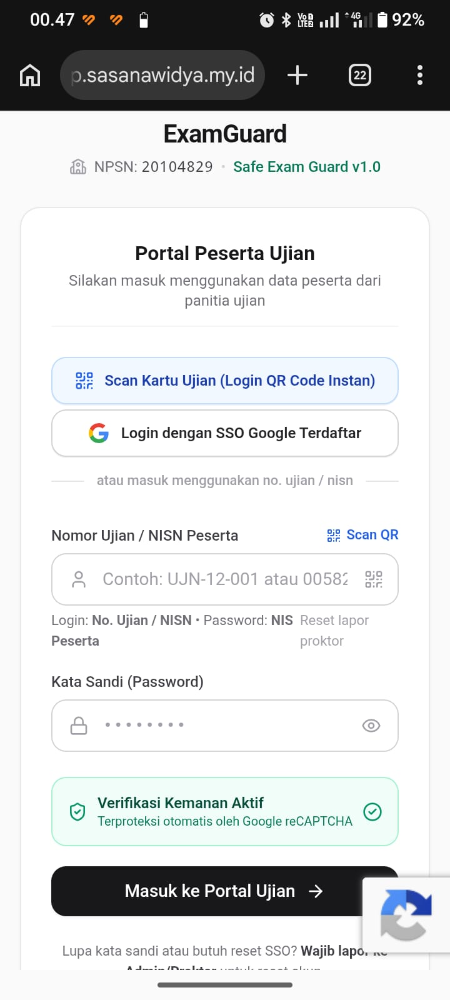
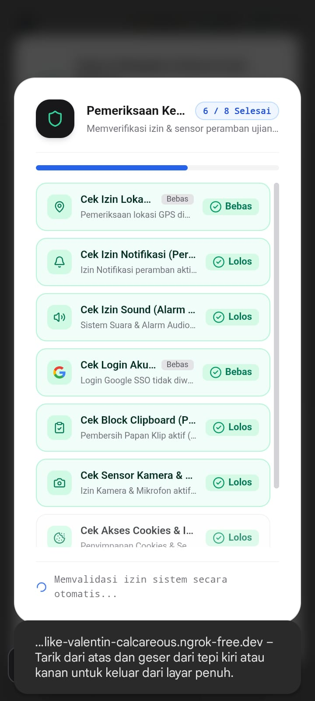
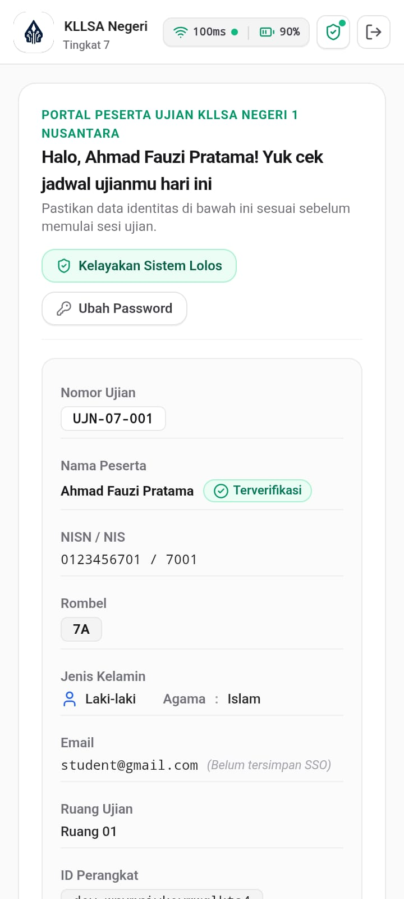
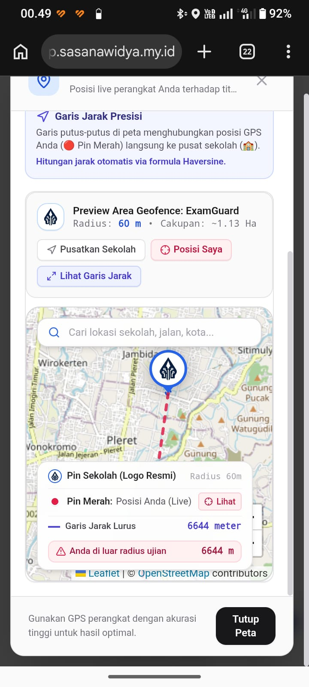
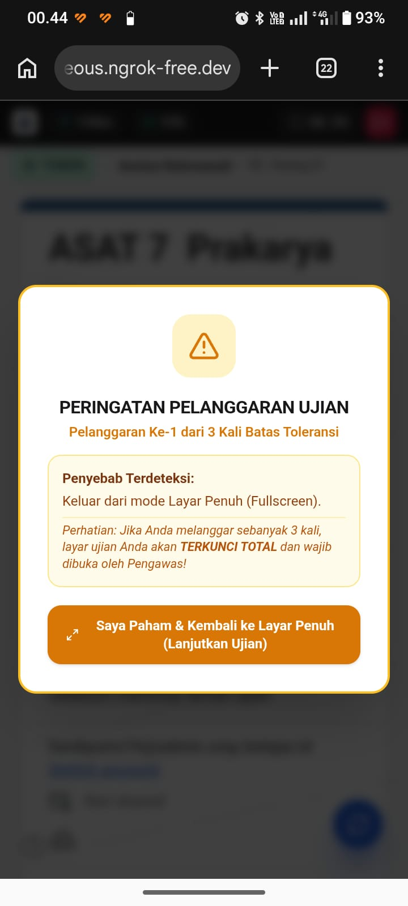
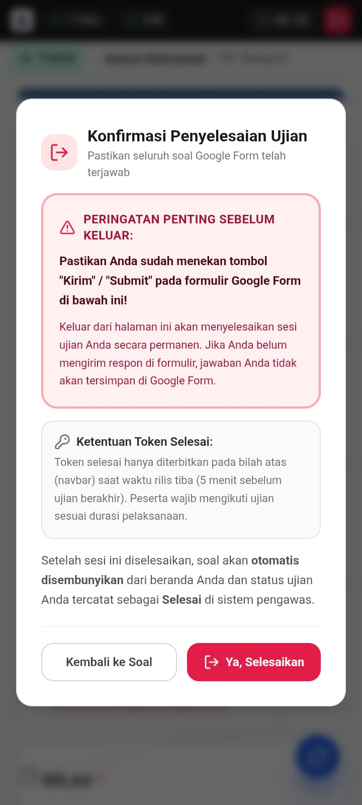

# 🛡️ ExamGuard v1.2 - Enterprise Exam Browser & Proctoring System

<div align="center">

[](https://github.com/chriz27/examguard)
[](https://react.dev)
[](https://vitejs.dev)
[](https://tailwindcss.com)
[](https://php.net)
[](https://nodejs.org)
[](https://sqlite.org)
[](LICENSE)

**Sistem Pengawasan & Pengamanan Asesmen Digital Modern Terstandar untuk Google Forms.**

*Tanpa perlu unduh instal aplikasi dari Play Store atau App Store — langsung berjalan aman, responsif, dan terkunci di seluruh peramban.*  
*(✅ Chrome Android, ✅ Chrome / Edge Desktop, ⚠ Safari iOS)*

---

### 👨‍💻 Tim Pengembang
Dikembangkan dengan penuh dedikasi oleh **Fandi dari Jawa tech**  
Untuk kemajuan ekosistem asesmen digital sekolah, madrasah, dan instansi pendidikan di seluruh Indonesia.

<div align="center" style="margin-top: 10px;">

[](https://saweria.co/chriz27)

</div>

</div>

---

## 💡 Apa Itu ExamGuard & Tujuan Aplikasi

**ExamGuard for Google Forms** adalah platform *Exam Browser* berbasis web modern yang dirancang untuk mengamankan jalannya asesmen atau ujian daring dengan Google Formulir. Siswa mengerjakan soal di dalam lingkungan peramban terkunci (*Kiosk Mode*) yang steril dari berbagai potensi kecurangan.

### 🎯 Tujuan & Latar Belakang Aplikasi
Banyak sekolah dan lembaga pendidikan di Indonesia menyelenggarakan asesmen digital (Ulangan Harian, Asesmen Sumatif/Formatif, Penilaian Akhir Semester, hingga Ujian Sekolah) menggunakan **Google Formulir (Google Forms)** karena kemudahan pembuatan soal dan pengoreksian otomatis. Namun, pelaksanaan ujian melalui Google Form standar memiliki celah kecurangan yang sangat tinggi:
* Peserta dapat dengan mudah membuka tab baru, mencari kunci jawaban di Google atau ChatGPT.
* Soal dan jawaban dapat disalin (*copy-paste*) ke grup perpesanan (WhatsApp/Telegram).
* Terjadi praktik joki ujian di mana akun siswa dikerjakan oleh orang lain dari luar sekolah atau rumah.
* Aplikasi *Exam Browser* berbasis Play Store/App Store sering membebani siswa (memori HP penuh, kendala tipe Android lawas, perizinan rumit, atau butuh biaya lisensi server tinggi).

### 🚀 Visi & Solusi ExamGuard
ExamGuard hadir untuk **mendekatkan teknologi asesmen aman kepada seluruh sekolah tanpa biaya lisensi mahal dan tanpa konfigurasi server yang rumit**. ExamGuard membungkus lembar soal Google Form di dalam lingkungan **Kiosk Sandbox Terkunci** berbasis peramban web modern yang menjamin integritas ujian:

1. **Fullscreen Lock:** Penguncian layar penuh seketika saat ujian dimulai; mendeteksi pergantian tab, split screen, dan shortcut terlarang.
2. **GPS Geofencing Presisi Tinggi:** Validasi radius koordinat berbasis sensor perangkat (hanya bisa login & mengerjakan di area sekolah tertentu).
3. **One-Device Lock:** Kunci satu akun hanya untuk satu perangkat fisik untuk mencegah perjokian atau login ganda.
4. **Penjadwalan Soal:** Buka dan tutup akses ujian secara otomatis sesuai jadwal waktu mulai dan selesai yang telah ditentukan proktor.
5. **Alarm Peringatan Pelanggaran:** Sirine otomatis berbunyi saat terjadi kecurangan ringan, serta layar merah penuh (*Red Screen*) saat akun dikunci.
6. **Token Auto-Rilis:** Rilis token soal dinamis dengan sistem hitung mundur (*countdown*) agar ujian dapat dimulai serentak.
7. **Google SSO & One Tap:** Otentikasi praktis akun Google Workspace sekolah yang aktif sejak halaman login hingga verifikasi kelayakan sistem.
8. **Google reCAPTCHA:** Perlindungan gerbang login dari serangan bot otomatis dan percobaan tebak password (*brute force*).
9. **Login Scan Kartu:** Kemudahan login peserta dengan memindai kode QR pada kartu ujian cetak mandiri atau massal.
10. **Multi-Device:** Berjalan mulus di berbagai perangkat siswa (Android, Laptop/PC Desktop, dan iOS Safari) tanpa perlu instal aplikasi tambahan.

> [!TIP]
> **Hosting Hemat & Bebas Rumit:** Aplikasi ini dapat dihosting dengan sangat hemat dan mudah di cPanel Shared Hosting biasa tanpa perlu konfigurasi server yang rumit maupun pengaturan database server karena ditenagai oleh SQLite bawaan.

---

## 🏛️ Arsitektur Sistem & Filosofi Desain

ExamGuard dirancang dengan prinsip **Client-First Resilient Architecture** yang mengutamakan kelancaran pengerjaan siswa di lapangan meskipun koneksi jaringan sekolah mengalami fluktuasi (*jitter*):

```
┌─────────────────────────────────────────────────────────────────────────────────┐
│                           ARSITEKTUR HYBRID EXAMGUARD                           │
├─────────────────────────────────────────────────────────────────────────────────┤
│  [SISWA / CLIENT BROWSER]                                                       │
│  React 19 + PWA Engine (Local State, Offline Safeguard, Hardware Sensors)       │
│      │                                                                          │
│      ├──► Fullscreen & Visibility Guard (Deteksi Tab & Layar Penuh)             │
│      ├──► Physical GPS Geofencing (Haversine Formula Radius Meter)              │
│      ├──► Device Fingerprint Engine (Penguncian 1 Akun = 1 HP)                  │
│      └──► Web Audio Alarm Context (Sirine Pelanggaran & Alarm Darurat)          │
│                                                                                 │
│  [BACKEND & STORAGE ENGINE]                                                     │
│  • cPanel Mode: PHP 8.0+ Single Entry API (api/index.php) + SQLite PDO (WAL)    │
│  • Local/VPS Mode: Node.js 18+ Express API + SQLite3 + WebSocket Push           │
│  • Database: api/examguard.db (Zero-Config, Atomic Transactions, Self-Contained)│
│                                                                                 │
│  [PROCTOR & ADMIN DASHBOARD]                                                    │
│  • Real-time Live Monitoring Hub (Heartbeat, Baterai, Ping Latensi ms)          │
│  • Remote Proctor Controls (Buka Kunci, Reset Pekerjaan, Reset Perangkat)       │
│  • Broadcast Engine (Pita Berjalan Marquee Running Text Real-time)              │
│  • Auto-OTA Updater (Pembaruan 1-Klik dari GitHub & Unggah ZIP Offline)         │
└─────────────────────────────────────────────────────────────────────────────────┘
```

### 1. Zero-Config Database (SQLite PDO & WAL Mode)
Tidak memerlukan pembuatan database MySQL terpisah, tanpa repot konfigurasi `DB_HOST`, `DB_USER`, atau `DB_PASSWORD`. Berkas database SQLite (`api/examguard.db`) terisolasi aman dengan proteksi file level dan transaksi atomik, siap menampung ribuan data siswa dan rekaman log pelanggaran.

### 2. Dual-Engine Backend (cPanel PHP & Node.js WebSocket)
* **cPanel Shared Hosting:** Berjalan mulus di hosting hemat dengan PHP 8.0+ via `api/index.php` REST endpoint.
* **VPS / Local Server:** Mendukung engine Node.js + WebSocket untuk sinkronisasi sub-detik yang sangat responsif.

### 3. Anti-Terkunci Permanen & Toleransi Aman
Sistem proctoring ExamGuard membedakan antara pelanggaran sementara (*warning banner/popup*) dan pelanggaran kumulatif berat (*lockout*). Siswa tidak akan kehilangan data formulir yang telah diisi saat layar terkunci karena Google Form berjalan di dalam iframe terisolasi yang terlindungi.

---

## ⚙️ Spesifikasi Teknologi & Status Server

| Komponen / Lapisan | Spesifikasi Teknologi | Keterangan & Peran |
| :--- | :--- | :--- |
| **Versi Rilis** | **ExamGuard v1.2.0 Stable** | Rilis stabil produksi dengan sistem OTA Updater terintegrasi |
| **Frontend Engine** | **React 19 & Vite 6** | Framework Single Page Application (SPA) modern, rendering reaktif, dan HMR ultra-cepat |
| **Styling Framework** | **Tailwind CSS v4.0 (HEX-Safe)** | Desain modern dengan palet standar sRGB HEX untuk kompatibilitas 100% pada Chrome & OS lawas |
| **Backend Runtime** | **cPanel Host (PHP 8.0+ PDO) & Node.js 18+** | Endpoint REST `api/index.php` atau runtime Express + WebSocket untuk LAN/VPS |
| **Database Engine** | **SQLite 3 (WAL Mode & ACID)** | Database berkas mandiri (0ms latensi lokal, zero-setup, atomic commit, dan konkurensi tinggi) |
| **Peta & Geofencing** | **Leaflet & OpenStreetMap** | Validasi radius jarak koordinat presisi tinggi menggunakan rumus Haversine |
| **Dukungan Web Server** | **Apache / LiteSpeed / Nginx / Node.js** | Kompatibel dengan berbagai lingkungan server hosting maupun server mandiri |
| **Protokol Jaringan** | **HTTPS (SSL/TLS Mandatory)** | Mewajibkan enkripsi HTTPS untuk akses sensor GPS, Kamera QR, dan Fullscreen API |
| **Autentikasi & Bot Guard** | **Google GIS (SSO) & reCAPTCHA v2/v3** | Login resmi Google Workspace, One Tap, reCAPTCHA, disertai **Captcha Mandiri Offline** |
| **Sensor Perangkat** | **HTML5 Web APIs** | Geolocation API (GPS), Fullscreen API, Page Visibility API, Battery Status, dan Web Audio API |
| **Sinkronisasi Data** | **Real-time Snapshot &bull; Mode WAL** | Penulisan data simultan dan sinkronisasi berkala tanpa konflik read-write |
| **Status Lisensi** | **The MIT License (Open Community)** | Bebas digunakan, dimodifikasi, dan didistribusikan untuk institusi pendidikan secara permanen |

---

## ✨ Fitur-Fitur Unggulan

```
┌────────────────────────────────────────────────────────────────────────────────┐
│                        FITUR UTAMA EXAMGUARD                                   │
├────────────────────┬────────────────────┬──────────────────────────────────────┤
│  🔒 Kiosk Lockdown │  📍 Geofence GPS   │  📱 One-Device Policy                │
│  Anti buka tab,    │  Kunci posisi riil │  1 akun hanya bisa dipakai           │
│  anti screenshot & │  koordinat sekolah │  di 1 perangkat (anti joki)          │
│  anti copy-paste   │  radius meter      │                                      │
├────────────────────┼────────────────────┼──────────────────────────────────────┤
│  📢 Broadcast Teks │  📊 Smart Proctor  │  🖨️ Cetak Kartu QR                   │
│  Pita pesan running│  Live monitor,     │  Format hemat A4 (6 kartu/lembar)    │
│  text real-time 3x │  status soal cerdas│  dengan QR Code scan masuk instan    │
├────────────────────┼────────────────────┼──────────────────────────────────────┤
│  ⚡ OTA Updater     │  🔑 Google SSO     │  ⏱️ 2-Tier Navbar                    │
│  Pembaruan 1-klik  │  Login akun resmi  │  Token mengarah ke bawah &           │
│  bebas hilang data │  Google Workspace  │  tombol segarkan soal mengambang     │
└────────────────────┴────────────────────┴──────────────────────────────────────┘
```

### 1. 🔒 Penguncian Peramban (*Kiosk Mode & Anti-Cheat*)
* **Fullscreen Strict Mode:** Mewajibkan layar penuh selama ujian berlangsung. Keluar dari fullscreen memicu peringatan seketika.
* **Clipboard Blocker:** Pembersihan otomatis papan klip (*clipboard*) mencegah trik salin-tempel kunci jawaban.
* **Shortcut & Context Menu Blocker:** Memblokir tombol F12, Ctrl+U, Ctrl+Shift+I, Alt+Tab, tombol kembali (*back button*), dan klik kanan.

### 2. 📍 GPS Geofencing Presisi Tinggi
* Koordinat diambil langsung dari sensor GPS fisik perangkat siswa (tidak dapat dimanipulasi manual).
* Admin dapat menentukan titik tengah Sekolah via OpenStreetMap/Google Maps dan radius toleransi jarak (misal: 100 meter dari gedung sekolah).

### 3. 🆔 Kebijakan Satu Perangkat (*One-Device Lock*)
* Perangkat siswa diikat dengan tanda pengenal digital unik (*Device Fingerprint*) saat pertama kali login.
* Mencegah akun siswa digunakan oleh orang lain di luar ruangan ujian. Tersedia tombol *Reset Perangkat* di dashboard pengawas jika HP siswa rusak/kehabisan baterai.

### 4. 📢 Fitur Broadcast Pengumuman Admin Real-time
* Tombol megaphone bulat mengambang di pojok kanan bawah dashboard Admin/Pengawas.
* Mendukung siaran langsung ("Kirim Sekarang") maupun terjadwal ("Jadwalkan Jam Tayang") dengan batas 100 karakter dan penghitung karakter riil (`57/100`).
* Pesan muncul sebagai pita berjalan (*marquee running text*) berwarna kuning-amber kontras di bagian paling atas portal admin dan seluruh peserta (baik di beranda maupun saat sedang mengerjakan soal).
* Berjalan tepat 3 kali putaran lalu hilang otomatis, dan hanya tayang 1 kali per sesi peranti.

### 5. 📊 Panel Pengawas Cerdas (*Smart Proctoring Hub*)
* Pantau status pengerjaan seluruh peserta (Sedang Mengerjakan, Belum Masuk, Terkunci, atau Selesai).
* **Status Jadwal Soal Cerdas:** Menampilkan badge *Berlangsung* (hijau), *Akan Datang* (biru), dan *Berakhir* (abu-abu/merah) di atas jam ujian.
* **Smart Sorting:** Tabel aktif otomatis menyortir soal yang sedang berlangsung di posisi teratas.
* **Reset Pekerjaan Teruji:** Tombol konfirmasi reset pekerjaan yang membersihkan riwayat pengerjaan, menghapus log pelanggaran, dan membuka kunci peranti seketika.

### 6. 🖨️ Cetak Kartu Peserta Ujian QR Code
* Cetak kartu peserta mandiri (perorangan) atau massal per kelas/tingkat.
* Format A4 hemat kertas (3 baris × 2 kolom = 6 kartu per lembar).
* Dilengkapi QR Code login cepat: siswa cukup mengarahkan kartu ke kamera untuk masuk secara instan tanpa mengetik NISN/kata sandi.

---

## 📸 Galeri Antarmuka & Tangkapan Layar (Screenshots)

Berikut adalah beberapa tangkapan layar antarmuka sistem ExamGuard v1.2 baik pada layar laptop/komputer (Desktop) maupun peramban ponsel pintar siswa (Mobile/HP):

### 🖥️ 1. Panel Admin & Pusat Kontrol Pengawas (Desktop View)

<div align="center">

#### 📊 Pusat Kontrol Pengawas (Live Proctoring Hub) & Hitung Mundur Token

*Pemantauan live peserta per tingkat/rombel, status pengerjaan, kontrol token masuk & selesai dengan countdown, tombol buka kunci/reset, live clock WIB, dan tombol broadcast.*

<br/>

#### 📋 Bank Sesi Ujian Google Form & Badge Status Soal

*Manajemen sesi ujian Google Form, status aktif "Sedang Berlangsung", rilis token dinamis, durasi waktu, dan tombol cetak kartu QR Code.*

<br/>

#### 🛡️ Konfigurasi Instansi & Ceklis Izin Browser (Pre-Flight Checks)

*Pengaturan keamanan Kiosk Mode: GPS geofencing, deteksi layar penuh, notifikasi, alarm audio, Google SSO, dan toleransi pelanggaran.*

<br/>

#### ⚡ Pusat Pembaruan Sistem (OTA Update Hub) & Informasi Rilis

*Pusat pembaruan Over-The-Air (OTA) 1-klik dari GitHub atau unggah berkas ZIP offline dengan proteksi isolasi database SQLite.*

</div>

---

### 📱 2. Portal Peserta Ujian (Mobile / Smartphone View)

<div align="center">

| 1. Login Peserta Bersih | 2. Verifikasi Kelayakan (Pre-Flight) | 3. Beranda Peserta Ujian |
| :---: | :---: | :---: |
|  |  |  |
| *Login bersih dengan Scan QR Kartu, Google SSO, dan Google reCAPTCHA* | *Validasi 8 sensor & izin peramban otomatis sebelum membuka soal* | *Navbar nama sekolah & tingkat (marquee looping), identitas, dan jadwal* |

| 4. Peta Geofence Radius GPS | 5. Peringatan Pelanggaran Ujian | 6. Konfirmasi Selesai Ujian |
| :---: | :---: | :---: |
|  |  |  |
| *Peta interaktif Leaflet OSM, pin live GPS, dan garis jarak Haversine* | *Popup peringatan pelanggaran (keluar fullscreen) & hitungan toleransi* | *Pengingat submit Google Form sebelum keluar & validasi token selesai* |

</div>

---

## 🚀 Resume Rilis: Pembaruan Versi 1.2 (Changelog Lengkap)

Pembaruan **ExamGuard v1.2** merupakan rilis stabilitas dan penyempurnaan fitur terbesar yang menghadirkan peningkatan antarmuka, keamanan proctoring, dan keandalan sistem:

| Fitur / Perbaikan | Status | Penjelasan & Rincian di Versi 1.2 |
| :--- | :---: | :--- |
| **⚡ Sistem Pembaruan Otomatis (OTA)** | **BARU** | Super Admin dapat memperbarui aplikasi langsung dari panel admin melalui **1-Klik Otomatis dari GitHub** atau **Unggah Berkas ZIP Offline**. Berkas database `api/examguard.db` **terproteksi 100% dan tidak pernah tertimpa**. |
| **🧹 Pembersihan Tampilan Login** | **UPDATE** | Antarmuka halaman masuk disederhanakan agar lebih bersih, modern, dan tidak membingungkan peserta. Tombol QR Code scanner dan Google SSO ditata proporsional dan elegan. |
| **🔄 Perbaikan Tombol Reset Pekerjaan** | **FIXED** | Perbaikan total pada alur konfirmasi reset pekerjaan di panel pengawas. Klik "Ya, Reset Pekerjaan" kini seketika menghapus attempt, mereset pelanggaran, melepaskan kunci peranti, dan memungkinkan siswa masuk kembali dari awal tanpa macet. |
| **🚨 Sistem Pelanggaran Ringan vs Berat** | **ENHANCED**| **Pelanggaran Ringan:** Keluar fullscreen / berpindah aplikasi memunculkan popup peringatan dengan penjelasan kesalahan dan hitungan pelanggaran real-time; alarm kontinu otomatis mati saat siswa kembali masuk fullscreen.<br>**Pelanggaran Berat:** Jika pelanggaran melebihi batas toleransi, lembar ujian seketika terkunci (*LOCKED*), alarm 3 detik berbunyi, dan memerlukan buka kunci dari proktor. |
| **⏱️ Status Soal & Auto-Sort Pengawas** | **BARU** | Kolom waktu pada tabel kontrol pengawas kini menampilkan badge status **"Berlangsung"** (hijau), **"Akan Datang"** (biru), dan **"Berakhir"** (abu-abu). Tabel otomatis menyortir soal yang sedang berlangsung di urutan teratas. |
| **📢 Fitur Broadcast Pesan Admin** | **BARU** | Tombol megaphone mengambang di pojok kanan bawah panel pengawas. Admin dapat mengirim teks pengumuman max 100 karakter (dilengkapi counter `xx/100`) secara langsung atau terjadwal. Pengumuman muncul sebagai pita berjalan (*marquee running text*) kontras di bagian atas beranda dan lembar soal peserta sebanyak 3x putaran. |
| **📱 Identitas Sekolah & Marquee Navbar HP** | **BARU** | Pada navbar beranda peserta khusus layar HP, di samping logo kini terdapat nama sekolah (baris 1) dan tingkat peserta (baris 2). Jika nama sekolah panjang dan terpotong layar, teks otomatis bergulir (*continuous marquee loop*) ke kiri secara halus agar terbaca penuh. |
| **🎈 Balon Petunjuk Token Ujian** | **FIXED** | Penataan ulang posisi balon panduan token ujian (`Token Mulai` hijau & `Token Selesai` merah) agar menggantung rapi di bawah tombol `[TOKEN]`, tidak tertutup oleh header hitam, dan tidak menutupi lembar soal Google Form. |

---

## 🔄 Panduan Pembaruan Aplikasi di cPanel (Dari v1.0 / v1.1 ke v1.2)

Jika Anda saat ini telah memiliki instalasi ExamGuard yang aktif di subdomain cPanel, Anda dapat memperbarui ke **v1.2** secara instan tanpa kehilangan data peserta maupun nilai ujian:

### 💡 Metode A: Pembaruan Melalui Panel Admin ExamGuard (1-Klik & Upload ZIP)
1. Masuk ke **Panel Admin ExamGuard** Anda menggunakan akun Super Admin (`admin`).
2. Buka menu **"Tentang Aplikasi"** di bilah menu samping.
3. Di bagian **Pemeriksaan Pembaruan Sistem**, pilih salah satu opsi:
   * **Opsi 1 (1-Klik Otomatis dari GitHub):** Klik **"Periksa Pembaruan Sekarang"**. Jika terdeteksi rilis v1.2, klik tombol hijau **"⚡ Pasang Pembaruan 1-Klik Otomatis"**. Sistem cPanel Anda akan mengunduh paket resmi dan memperbarui berkas secara instan.
   * **Opsi 2 (Unggah Berkas ZIP Offline):** Pada kartu opsi 2, klik **"Pilih Berkas ZIP..."**, pilih berkas **`ExamGuard-v1.2.zip`**, lalu klik **"🚀 Verifikasi & Pasang Pembaruan"**.
4. Setelah muncul jendela dialog **"Pembaruan Berhasil Dipasang!"**, klik tombol **"🔄 Muat Ulang Halaman Sekarang"**.

---

### 🛠️ Metode B: Pembaruan Manual via File Manager cPanel
Jika server hosting Anda berada di balik firewall tertutup (*offline*):
1. **Langkah 1 (Pencegahan): Cadangkan Database SQLite**
   * Masuk ke folder `api/` di File Manager cPanel, unduh berkas **`examguard.db`** ke laptop Anda.
2. **Langkah 2: Unggah Berkas `ExamGuard-v1.2.zip`**
   * Unggah berkas `ExamGuard-v1.2.zip` ke folder utama subdomain ujian Anda.
3. **Langkah 3: Ekstrak Berkas Pembaruan**
   * Klik kanan pada berkas zip, pilih **Extract** (timpa file kode frontend `index.html`, `assets/`, dan `api/index.php`).
   * *Catatan: Berkas rilis resmi bebas dari file database, sehingga berkas `api/examguard.db` Anda tetap aman 100%!*
4. **Langkah 4: Selesai**
   * Hapus file zip dan buka website ujian dengan menekan **Ctrl + F5** (Hard Refresh).

---

## 🌐 Panduan Pasang Baru di cPanel (Zero-Config SQLite)

ExamGuard tidak memerlukan pembuatan database MySQL. Ikuti 3 langkah praktis berikut:

### Langkah 1: Siapkan Subdomain di cPanel
1. Masuk ke cPanel hosting sekolah Anda &rarr; Buka menu **Domains** atau **Subdomains**.
2. Buat subdomain baru (contoh: `ujian.sekolah.sch.id`).
3. Catat folder tujuannya (*Document Root*), biasanya otomatis di `public_html/ujian`.

### Langkah 2: Unggah & Ekstrak Berkas Rilis
1. Masuk ke **File Manager** cPanel &rarr; Buka folder `public_html/ujian`.
2. Klik tombol **Upload**, unggah berkas **`ExamGuard-v1.2.zip`**.
3. Ekstrak berkas tersebut langsung di dalam folder subdomain.

### Langkah 3: Aktifkan Sertifikat SSL (HTTPS)
1. Buka menu **SSL/TLS Status** di cPanel.
2. Centang subdomain ujian Anda, lalu klik **Run AutoSSL**.
3. Selesai! Buka subdomain Anda di peramban: `https://ujian.sekolah.sch.id`.

> [!IMPORTANT]
> **Wajib Protokol HTTPS:** Sensor GPS dan izin Kiosk Layar Penuh modern memerlukan protokol aman HTTPS. Pastikan SSL AutoSSL cPanel sudah berstatus hijau aktif.

---

## 🔑 Kredensial Akun Default

Setelah instalasi selesai, sistem telah terisi akun bawaan:

| Peran Akun | Username | Password Default | Hak Akses |
| :--- | :--- | :--- | :--- |
| **Super Admin** | `admin` | `admin123` | Akses penuh: Pengaturan Instansi, Bank Soal, Akun, Import Siswa, Backup & Restore, OTA Updater |
| **Proktor Ujian** | `proktor` | `proktor` *(atau `proktor123`)* | Khusus pengawasan: Pantau peserta, rilis token, reset pekerjaan, reset perangkat, dan cetak berita acara |
| **Contoh Siswa** | `0068291033` | `23101` *(Nomor NIS)* | Portal peserta untuk mengerjakan ujian |

> [!TIP]
> Demi keamanan, segera perbarui kata sandi Super Admin melalui menu **Akun Administrator** setelah instalasi pertama kali.

---

## 🔐 Integrasi Google OAuth 2.0 (SSO) & reCAPTCHA

Pengaturan integrasi Google dapat dikelola langsung melalui menu **Pengaturan Instansi** (Khusus Super Admin):

### 1. 🔑 Google OAuth 2.0 Client ID (Login Akun Google Siswa)
* Memungkinkan instansi mewajibkan siswa masuk menggunakan akun resmi Google Workspace sekolah (misal `@sekolah.sch.id` atau `@belajar.id`).
* Dapatkan **Client ID** tipe *Web application* melalui [Google Cloud Console](https://console.cloud.google.com/).
* Masukkan URL domain Anda (misal `https://ujian.sekolah.sch.id`) pada kolom **Authorized JavaScript origins**.
* Tempelkan Client ID pada menu Pengaturan Instansi ExamGuard dan aktifkan ceklis izin Google SSO.

### 2. 🛡️ Google reCAPTCHA & Captcha Mandiri Offline
* Dukungan **reCAPTCHA v2 (Checkbox)** dan **reCAPTCHA v3 (Background Score)** untuk mencegah serangan bot.
* **Captcha Mandiri Bawaan:** Jika sekolah tidak ingin menggunakan Google reCAPTCHA atau mengadakan ujian di jaringan intranet/LAN offline, cukup kosongkan kolom Site Key. ExamGuard akan mengaktifkan Captcha 5-karakter lokal secara otomatis tanpa butuh akses internet ke Google.

---

## 💻 Panduan Menjalankan di Komputer Lokal (Pengembang)

```bash
# 1. Kloning repositori & masuk ke direktori proyek
git clone https://github.com/chriz27/examguard.git
cd examguard

# 2. Pasang dependensi Node.js
npm install

# 3. Jalankan server pengembangan Vite
npm run dev
# Buka di peramban: http://localhost:5173

# 4. Jalankan pengujian integrasi database & keamanan
npm run test:db

# 5. Kompilasi siap rilis (Production Build)
npm run build
# Berkas siap saji akan tersedia di direktori dist/
```

---

## 🛠️ Tanya Jawab & Pemecahan Masalah (FAQ)

### Q: Mengapa siswa mendapat pesan "Geolocation Denied" saat login?
> **Solusi:** Sensor GPS pada peramban Chrome dan Safari **hanya diizinkan aktif jika website menggunakan protokol aman HTTPS**. Pastikan website dibuka dengan `https://`. Jika sedang simulasi atau di ruangan tanpa sinyal GPS, admin dapat mengaktifkan **Mode Simulasi (Bypass GPS)** di menu pengaturan.

### Q: Mengapa muncul halaman 404 Not Found saat menekan tombol refresh di browser?
> **Solusi:** Pastikan berkas **`.htaccess`** yang disertakan pada paket rilis sudah terunggah di folder root subdomain cPanel Anda untuk merutekan Single Page Application ke `index.html`.

### Q: Apakah data siswa akan hilang saat sistem diperbarui ke versi baru?
> **Solusi:** **Sama sekali tidak hilang.** Database disimpan secara mandiri di berkas `api/examguard.db`. Sistem pembaruan ExamGuard v1.2 telah dilengkapi proteksi isolasi data sehingga proses pembaruan hanya memperbarui berkas frontend dan script API tanpa pernah menimpa database yang sudah ada.

---

<div align="center">

Dibuat dengan ❤️ oleh **Fandi dari Jawa tech**  
*Mendukung asesmen digital sekolah yang jujur, aman, dan berintegritas tinggi.*

</div>
